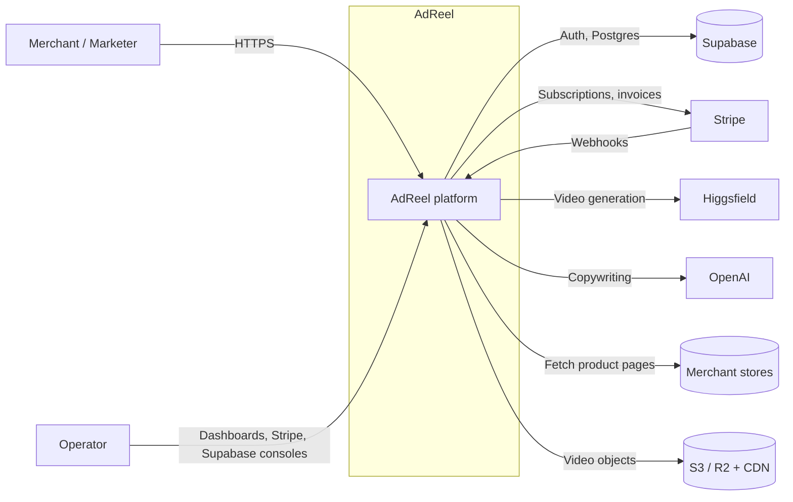
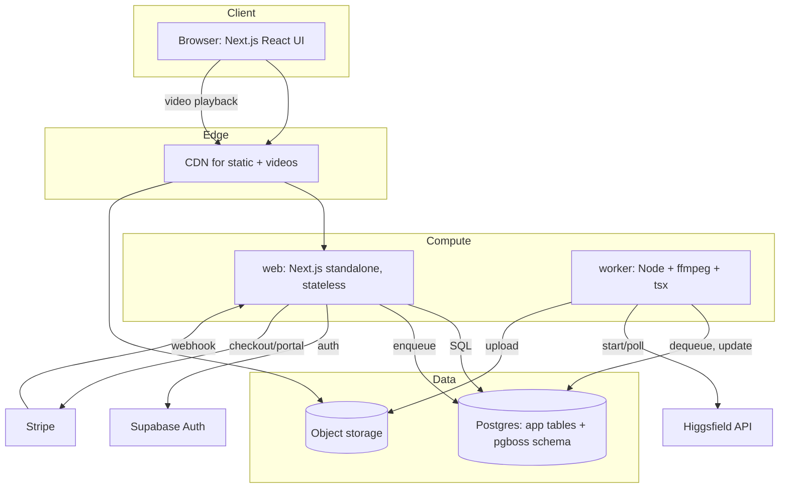
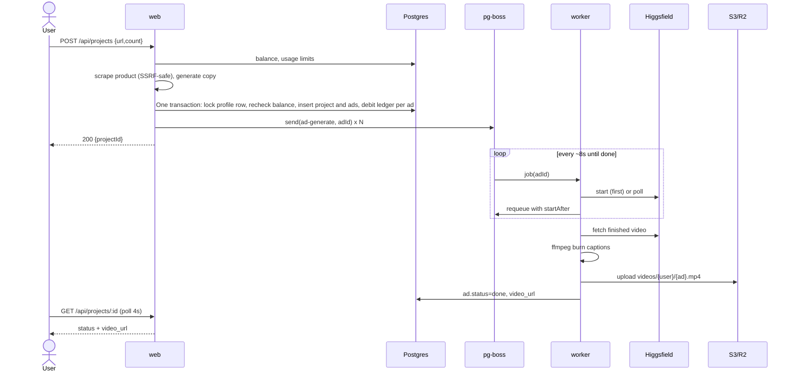
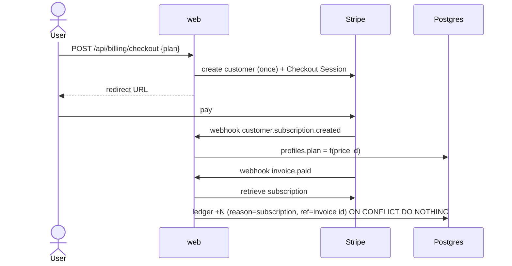
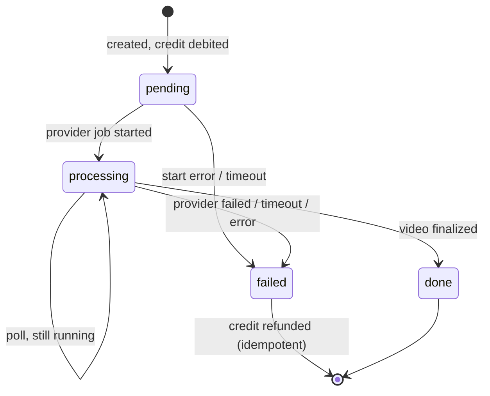

# 02. System architecture

## 1. C4 level 1: system context

## 2. C4 level 2: containers

**Notes**
- `web` holds no state; any instance can serve any request. Sessions are cookies validated against Supabase.
- Postgres is both system of record and queue (pg-boss). This keeps v1 operationally small; see ADR-002 for the migration path.
- Workers are independently scaled; a crashed worker's job is retried by the queue.

## 3. C4 level 3: web component view
| Component | Path | Depends on |
|---|---|---|
| Proxy (session refresh) | `src/proxy.ts` | Supabase SSR |
| Auth/profile | `src/lib/auth.ts`, `src/lib/supabase.ts` | Supabase, db |
| Project API | `src/app/api/projects` | auth, scrape, script, ratelimit, queue, db |
| Billing API | `src/app/api/billing/*`, `src/app/api/stripe/webhook` | stripe lib, db |
| Scraper | `src/lib/scrape.ts` | dns, net, fetch |
| Copy generator | `src/lib/script.ts` | OpenAI (optional) |
| Data access | `src/lib/db.ts` | pg |
| Queue producer | `src/lib/queue.ts` | pg-boss |

Worker components: queue consumer (`worker/index.ts`), job state machine (`src/lib/jobs.ts`), provider (`src/lib/video`), captions (`src/lib/captions.ts`), storage (`src/lib/storage.ts`).

## 4. Sequence: generate ads

## 5. Sequence: subscribe

Webhook handlers are idempotent: plan update is a pure set, grants are keyed by invoice id.

## 6. Ad state machine

Transitions are guarded by `WHERE status IN (...)` updates so duplicate job deliveries cannot double-refund or overwrite a finished ad.

## 7. Failure modes and handling
| Failure | Effect | Mitigation |
|---|---|---|
| Worker crash mid job | Job expires and retries | pg-boss retry/backoff; steps idempotent |
| Duplicate job delivery | Double processing | Status-guarded updates; unique refund key |
| Provider outage | Ads fail | Fail fast + refund; [Planned] failover provider, circuit breaker |
| Storage outage | No captions/upload | Falls back to provider URL; [Planned] retry/re-host |
| ffmpeg error | No captions | Falls back to uncaptioned video |
| Stripe webhook delay/replay | Late/duplicate grants | Idempotency keys; retrieve-from-source |
| DB failover | Brief errors | Retry on client; pooled connections; managed HA |
| Scrape target slow/hostile | Request stalls | 12 s timeout, redirect cap, private-IP block |
| Queue enqueue fails after commit | Paid ad never starts | Compensating fail + refund (implemented); [Planned] outbox reconciler |

## 8. API surface (v1)
| Method | Path | Auth | Purpose |
|---|---|---|---|
| POST | /api/auth/signup, login, logout | public/session | Supabase wrappers |
| POST | /api/projects | session | Create project and enqueue ads |
| GET | /api/projects/:id | session, owner | Project with ads and status |
| POST | /api/billing/checkout | session | Stripe Checkout URL |
| POST | /api/billing/portal | session | Stripe portal URL |
| POST | /api/stripe/webhook | Stripe signature | Plan and credit sync |

[Planned] versioned public API with API keys, per-key rate limits and outbound webhooks for agencies.
