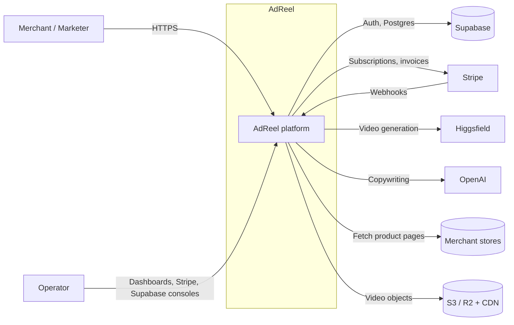
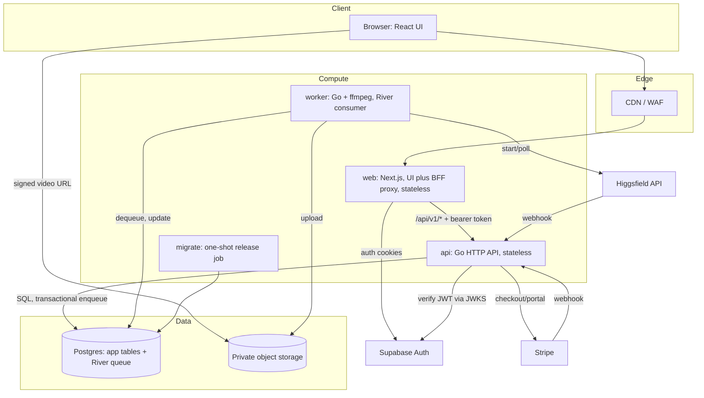
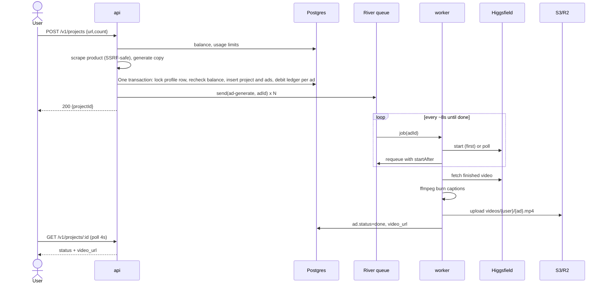
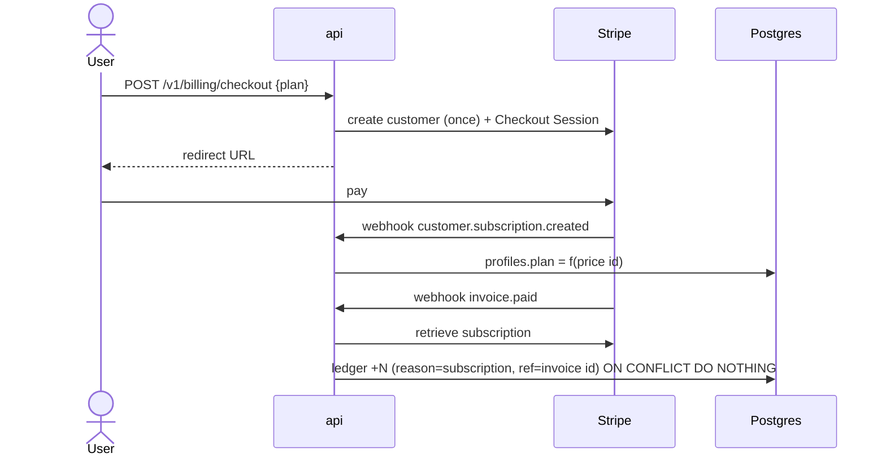
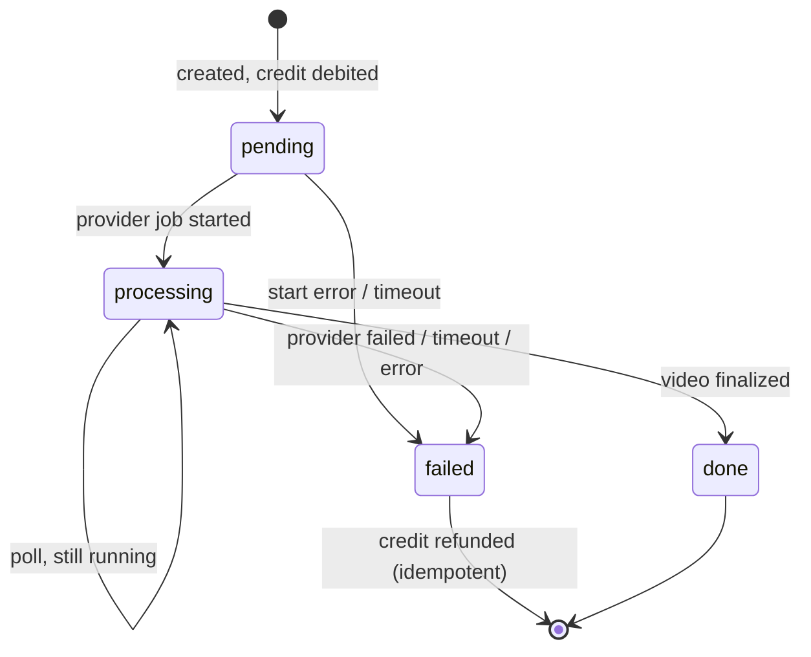

# 02. System architecture

## 1. C4 level 1: system context

## 2. C4 level 2: containers

**Notes**
- `web` holds the session cookie (httpOnly) and forwards `/api/v1/*` to `api` with an `Authorization: Bearer` header; it contains no business logic. A separate mobile app or API-key customers can call `api` directly using the OpenAPI contract.
- `api` is stateless; any instance serves any request. It verifies Supabase JWTs (JWKS or HS256) on every call.
- Postgres is both system of record and queue (River). Jobs are inserted in the same transaction as the credit debit (transactional outbox), so a paid ad can never exist without its job.
- Workers scale independently; a crashed worker's job is retried by River and stale jobs are re-enqueued by the reconciler.

## 3. C4 level 3: component view (backend)
| Package | Responsibility |
|---|---|
| `internal/api` | Routes, handlers, request validation, webhooks, account export/delete |
| `internal/auth` | JWT verification (Supabase JWKS/HS256, dev tokens), profile bootstrap |
| `internal/store` | pgx pool, transactions, migrations, all SQL |
| `internal/jobs` | River workers: generation state machine, reconciler, error handler (refund on exhaustion) |
| `internal/video` | Provider interface: Higgsfield and mock; retry/permanent error classes |
| `internal/scrape` | Product extraction with dial-time IP validation |
| `internal/moderation`, `internal/copywriter` | Category blocking, claim scrubbing, copy generation |
| `internal/billing` | Stripe checkout, portal, webhook handling, credit grants |
| `internal/storage`, `internal/captions` | S3 client with signed URLs; ffmpeg caption burn-in |
| `internal/httpx`, `internal/logx`, `internal/config` | Middleware, metrics, structured logs and alerts, validated configuration |

Frontend (`web/`): pages (`src/app`), BFF proxy (`src/app/api/v1/[...path]`), auth cookie routes (`src/app/api/auth/*`), session refresh (`src/proxy.ts`), typed client from the OpenAPI spec (`src/lib/api-types.ts`).

## 4. Sequence: generate ads

## 5. Sequence: subscribe

Webhook handlers are idempotent: plan update is a pure set, grants are keyed by invoice id.

## 6. Ad state machine

Transitions are guarded by `WHERE status IN (...)` updates so duplicate job deliveries cannot double-refund or overwrite a finished ad.

## 7. Failure modes and handling
| Failure | Effect | Mitigation |
|---|---|---|
| Worker crash mid job | Job expires and retries | River retry with backoff, then refund via error handler; steps idempotent |
| Duplicate job delivery | Double processing | Status-guarded updates; unique refund key |
| Provider outage | Ads fail | Fail fast + refund; [Planned] failover provider, circuit breaker |
| Storage outage | No captions/upload | Falls back to provider URL; [Planned] retry/re-host |
| ffmpeg error | No captions | Falls back to uncaptioned video |
| Stripe webhook delay/replay | Late/duplicate grants | Idempotency keys; retrieve-from-source |
| DB failover | Brief errors | Retry on client; pooled connections; managed HA |
| Scrape target slow/hostile | Request stalls | 12 s timeout, redirect cap, private-IP block |
| Queue enqueue fails after commit | Paid ad never starts | Ads stay `pending` (credit already reserved atomically); the per-minute reconciler re-enqueues any active ad not updated for 3 minutes [Implemented] |

## 8. API surface (v1)
The contract is `backend/api/openapi.yaml` (TypeScript types for the frontend are generated from it and CI fails on drift).
| Method | Path | Auth | Purpose |
|---|---|---|---|
| GET | /healthz, /readyz, /metrics | none (metrics optional token) | Probes and Prometheus |
| GET | /v1/plans | none | Plan catalogue |
| POST | /v1/dev/login | none, dev only | Dev token (404 in production) |
| GET | /v1/me | bearer | User, plan, credit balance |
| GET/POST | /v1/projects | bearer | List / create project and enqueue ads |
| GET | /v1/projects/{id} | bearer, owner | Project with live ad status and signed video URLs |
| POST | /v1/billing/checkout, /v1/billing/portal | bearer | Stripe URLs |
| GET/DELETE | /v1/account/export, /v1/account | bearer | GDPR export / deletion |
| POST | /v1/webhooks/stripe, /v1/webhooks/higgsfield | signature | Provider callbacks |

Errors are `{ "error": "<user-safe message>", "code": "<machine code>" }`. [Planned] API keys with per-key rate limits and outbound webhooks for agencies.
