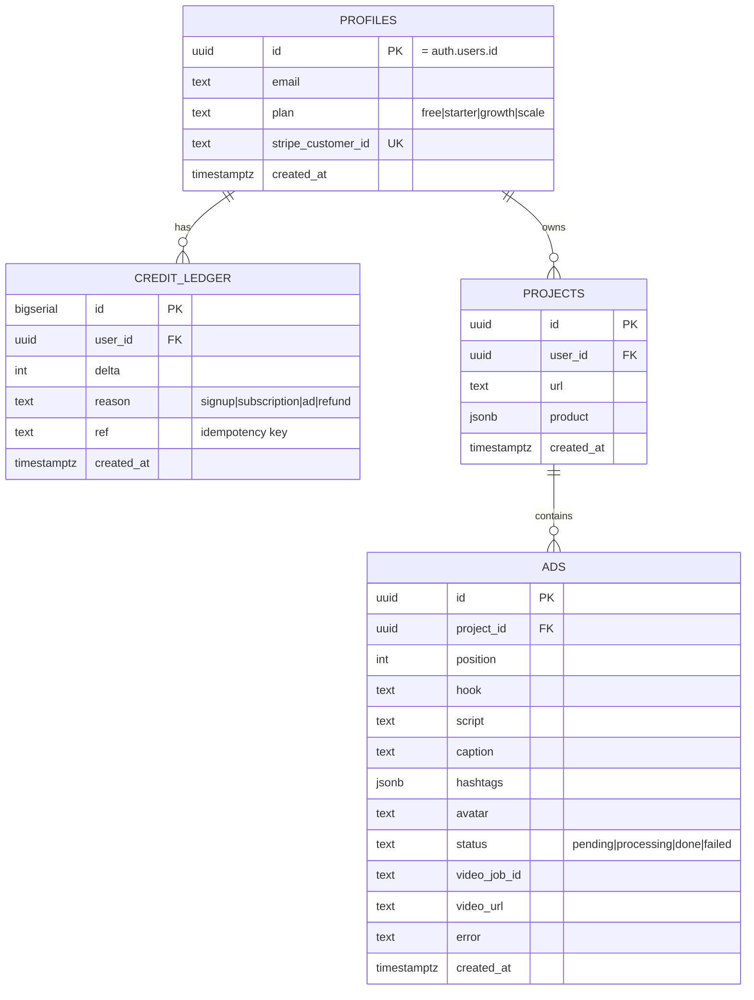

# 03. Data architecture

## 1. Stores
| Store | Technology | Holds | Durability |
|---|---|---|---|
| System of record | Postgres (Supabase) | profiles, ledger, projects, ads, queue | Managed backups + PITR |
| Auth | Supabase Auth (`auth` schema) | credentials, sessions | Managed |
| Objects | S3-compatible (R2/S3/MinIO) | Finished videos | 11x9 class durability (provider) |
| Billing | Stripe | Customers, subscriptions, invoices, cards | Stripe is source of truth for money |

## 2. ER diagram

Indexes: `credit_ledger(user_id)`, unique partial `credit_ledger(reason, ref) WHERE ref IS NOT NULL`, `projects(user_id, created_at DESC)`, `ads(project_id)`.

## 3. Credit ledger design
- **Append-only.** Balance is `SUM(delta)` per user. No mutable counter, so every change is auditable and replayable.
- **Idempotency.** Unique `(reason, ref)`: signup ref = user id, subscription ref = Stripe invoice id, ad debit ref = ad id, refund ref = ad id. Replays use `ON CONFLICT DO NOTHING`.
- **No overdraft.** Project creation locks the `profiles` row (`SELECT ... FOR UPDATE`), re-reads the balance in the same transaction, then inserts debits. Concurrent requests for one user serialize.
- **Refunds.** A failed ad refunds exactly once because the failure transition is status-guarded and the refund key is the ad id.
- **Scaling the balance read.** `SUM` over a user's rows is cheap while rows per user are small. [Planned] when it grows: maintain a `balances` table updated in the same transaction, with a periodic reconciliation job comparing it to the ledger.
- **Expiry/rollover.** v1 credits do not expire. [Planned] `expires_at` buckets consumed FIFO if policy requires monthly reset.

## 4. Consistency and transactions
| Operation | Guarantee |
|---|---|
| Create project + ads + debits | Single transaction (atomic) |
| Enqueue jobs | After commit. If enqueue fails the ads stay `pending` and the reconciler (scheduled every minute, deduplicated with `singletonKey`) re-enqueues them [Implemented]. [Planned] true transactional outbox (pg-boss can share the transaction) |
| Ad status transitions | Conditional updates, at-least-once processing, effectively exactly-once outcome |
| Stripe sync | Eventually consistent, idempotent, re-derivable from Stripe |

## 5. Product snapshot
`projects.product` stores the scraped product (title, description, price, image URLs) as jsonb, so later regenerations do not depend on the live page. Images are linked, not copied. [Planned] copy images to own storage for stability and so providers never hotlink merchant servers.

## 6. Retention and deletion
| Data | Retention [Assumption] | Notes |
|---|---|---|
| Videos | Life of account + 30 days; free tier 30 days | Lifecycle rule on bucket [Planned] |
| Projects/ads | Life of account | Cascade delete from profile |
| Ledger | 7 years financial record | Anonymize user link on erasure, keep amounts |
| Queue history | 7-14 days | pg-boss archive/delete settings |
| Logs | 30-90 days | No secrets, no passwords |
Account deletion [Implemented, `DELETE /api/account`, requires typing the account email]: cancels Stripe subscriptions, deletes objects under `videos/{user}/`, deletes the Supabase user (needs `SUPABASE_SERVICE_ROLE_KEY`), then deletes the profile (cascades projects/ads). The ledger FK was dropped in migration 002 so financial rows remain, keyed only by an opaque id. Each step is idempotent so a failed deletion can be retried. Export: `GET /api/account/export` [Implemented].

## 7. Growth and partitioning
| Table | Growth driver | Plan |
|---|---|---|
| `credit_ledger` | ~2-3 rows per ad | Range partition by month at hundreds of millions of rows; archive cold partitions |
| `ads` | 1 per video | Partition by `created_at`; hot status index on non-terminal rows |
| `projects` | 1 per submit | Index on `(user_id, created_at)` already supports dashboards |
| pgboss | Poll requeues | Tune poll interval; move to dedicated DB/queue at scale (doc 07) |

## 8. Migrations
Versioned SQL migrations live in `migrations/` and are applied in order by `npm run migrate` and at worker start, inside transactions under an advisory lock, recorded in `schema_migrations` with a checksum (editing an applied migration fails loudly) [Implemented]. Convention: expand/contract, never edit applied files. The web tier does not migrate.

## 9. Row Level Security
Server code connects with a privileged connection and enforces ownership in queries. [Planned] enable RLS on all tables as defense in depth, and use a least-privilege DB role for the web tier distinct from the worker.
