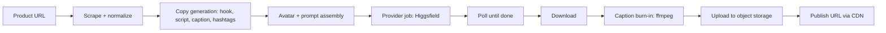

# 04. Video generation pipeline

## 1. Stages

## 2. Scraping
- Shopify products: try `/products/<handle>.json` first (structured), else OpenGraph/meta tags and `<title>`.
- Limits: 12 s timeout, 1.5 MB body cap, max 4 redirects, each hop re-validated.
- SSRF controls: reject non-http(s); resolve DNS and reject loopback, private, link-local, CGNAT, multicast, IPv6 ULA/link-local, and IPv4-mapped IPv6.
- Known gap [Planned]: DNS rebinding between check and connect. Fix by pinning the resolved IP in a custom agent, or run the scraper in an egress-restricted sandbox.
- [Planned] headless-render fallback for JS-heavy stores, structured data (JSON-LD) parsing, per-URL cache.

## 3. Copy generation
- OpenAI chat completion returning JSON `{ads:[{hook,script,caption,hashtags}]}`; one distinct angle per variant.
- Deterministic template fallback when no key or on error, so the pipeline never blocks on the LLM.
- [Planned] prompt/version registry, output validation (length, claims), policy filter, evaluation set, per-niche tone presets.

## 4. Provider abstraction
`VideoProvider { start(ad, product) -> jobId; poll(jobId) -> {processing|done|failed} }`.
- Implementations: Higgsfield (HTTP) and mock (placeholder clip for demo).
- Verified against the official Higgsfield API docs (docs.higgsfield.ai): `Authorization: Key <id>:<secret>`; asynchronous lifecycle `queued -> in_progress -> completed | failed | nsfw | canceled`; submit returns `request_id`; status at `GET /requests/{id}/status` with output in `video.url`; optional `Idempotency-Key` header; optional `hf_webhook` query parameter; `429` with `Retry-After` when the account queue is full; output retained 7 days (`expires_at`) unless shortened; `DELETE /requests/{id}` removes files and prompt.
- Selection by environment (`HIGGSFIELD_*` set => real).
- [Planned] additional providers (Runway, Kling, Veo, Sora-class, Heygen-style avatars), a router choosing by cost, latency, quota and content type, and a circuit breaker that fails over on elevated error rate.
- **Still unverified:** the model-specific request body. Higgsfield documents each model separately (console.higgsfield.ai). `HIGGSFIELD_MODEL` is the endpoint path and the body fields in `src/lib/video/index.ts` (`prompt`, `aspect_ratio`, `duration`, `image_url`) must be matched to the chosen model's schema and tested with a real account.
- Submissions send `Idempotency-Key = adId`, so an ambiguous timeout or retry never creates a duplicate paid generation.
- `429`/`503` from the provider are treated as retryable: the job is requeued after `Retry-After` and the credit stays reserved, instead of failing the ad.
- After a finished video is copied to our storage, the provider copy (including the prompt) is deleted via `DELETE /requests/{id}` as data minimization.

## 5. Job lifecycle (worker)
1. Dequeue `{adId}`; load ad + project in one query; skip if terminal.
2. If older than 25 min: fail + refund.
3. If no provider job yet: `start`, persist `video_job_id`, set `processing`, requeue after 8 s.
4. Else `poll`: still running => requeue; failed => fail + refund; done => finalize.
5. Finalize: download, burn captions, upload, set `done` with the public URL.
Queue config: retries 3 with exponential backoff, expiry 900 s, local concurrency `WORKER_CONCURRENCY` (default 5).
Why requeue-poll instead of a long-held job: workers never hold a slot while waiting on the provider, so concurrency is bounded by CPU/ffmpeg, not by provider latency.

**Webhooks [Implemented, optional]:** when `APP_URL` is https and `HIGGSFIELD_WEBHOOK_SECRET` is set, submissions include `hf_webhook`. `POST /api/higgsfield/webhook` verifies the Standard Webhooks signature (HMAC-SHA256 over `webhook-id.webhook-timestamp.body`, 5-minute tolerance, constant-time compare, supports multiple `v1,` signatures for secret rotation), then only enqueues an immediate job for the matching ad. The worker still confirms by polling the authenticated status endpoint, so a forged or replayed webhook can never inject a video URL, and duplicate deliveries are harmless. Polling stays as the fallback, as Higgsfield recommends when retention is shorter than the retry window.

## 6. Captions
- Script split into ~4-word cues timed evenly over probed duration (ffprobe), written as SRT.
- ffmpeg `subtitles` filter with bold, outlined style positioned above the bottom UI safe area, audio stream copied, `+faststart` for streaming.
- Failure is non-fatal: the uncaptioned video is delivered.
- [Planned] word-level timing from speech alignment (ASR/forced alignment) for accurate karaoke-style captions, brand fonts and colors, safe-zone presets per platform.

## 7. Storage and delivery
- Key: `videos/{userId}/{adId}.mp4`, immutable cache headers, public base URL (CDN-fronted bucket).
- Without S3 config the provider URL is used directly (may expire, no captions).
- [Planned] signed URLs for private content, bucket lifecycle rules, thumbnail extraction, multi-bitrate/HLS, watermark on free tier, download counting.

## 8. Quality and safety
- [Planned] automated checks: duration/resolution, audio present, black-frame detection, profanity and restricted-claim scan on script before spending provider credit.
- [Planned] human-in-the-loop approval mode for agencies.
- Disclosure: AI-generated avatar content should be labeled where platforms or law require (see doc 05).

## 9. Capacity and cost levers
| Lever | Effect |
|---|---|
| Plan credit pricing | Sets margin over provider cost |
| Per-user hourly/daily caps | Bounds abuse and runaway spend |
| Free tier = 1 video, watermark [Planned] | Limits acquisition cost |
| Provider router | Cheapest adequate model per request |
| Higgsfield concurrency limit | Excess requests queue provider-side; the queue is capped at a multiple of the account limit, beyond which submissions get `429`. Size `WORKER_CONCURRENCY` and plan caps to it, and ask Higgsfield before traffic increases |
| Prompt/duration tuning | Shorter clips reduce cost |
| Scrape cache | Avoids repeated fetches |
