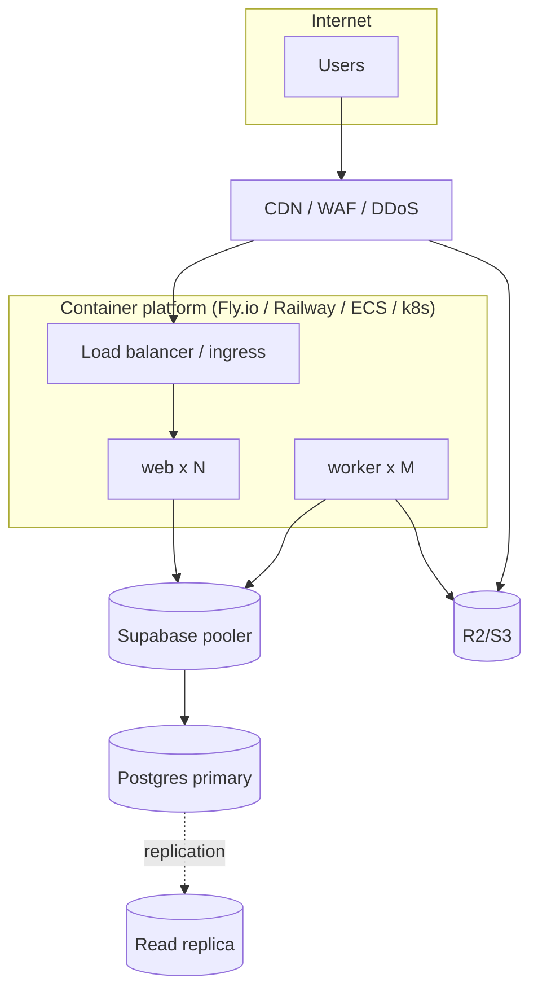

# 06. Infrastructure and operations

## 1. Environments
| Env | Purpose | Data | Providers |
|---|---|---|---|
| local | Development | Local or dev Supabase project | Mock video, Stripe test |
| preview [Planned] | Per-PR deploy | Seeded dev DB | Mock video, Stripe test |
| staging | Pre-prod validation | Anonymized/test | Real Higgsfield low quota, Stripe test |
| production | Customers | Real | All live |
Each environment has its own Supabase project, Stripe account mode, bucket, and secret set. No shared databases.

## 2. Runtime topology

- `web`: Next.js `output: standalone`, port 3000, non-root, health check `/api/health`. Scale on CPU and request rate.
- `api`: static Go binary on distroless, port 8080, `/readyz` (database ping), `/metrics`. Scale on CPU/latency; `GOMAXPROCS` follows the container limit.
- `worker`: Go + ffmpeg (alpine), port 9090 for probes and metrics. Scale on queue depth and ffmpeg CPU.
- `migrate`: one-shot image run before each rollout.
- `worker`: scale on queue depth and ffmpeg CPU. Graceful shutdown on SIGTERM (`boss.stop`).
- Connections: use the Supabase pooler. River uses LISTEN/NOTIFY and migrations take an advisory lock, so use session-mode or direct connections (not transaction pooling) for `worker` and `migrate`; keep `PG_POOL_MAX` small per instance and budget total connections = instances x pool.

## 3. Build and release
Pipeline [Planned]:
1. PR: install, lint, typecheck, unit tests, build, container build, dependency + image scan.
2. Merge to main: build images, tag by git SHA, push to registry, deploy to staging, run smoke tests.
3. Promote to production with rolling or blue/green deploy; automatic rollback on failed health checks.
4. Database migrations run before app rollout using expand/contract so old and new versions coexist.
Feature flags [Planned] for risky changes (new provider, new pricing). `NEXT_PUBLIC_*` values are baked at build time, so each environment builds its own image or uses a runtime config endpoint.

## 4. Observability
| Signal | Tooling [Planned] | Key items |
|---|---|---|
| Errors | Sentry (web + worker) | Unhandled errors, failed ads with provider error class |
| Logs | Structured JSON to Loki/Datadog | Request id, user id (hashed), ad id, job id |
| Metrics | Prometheus/OpenTelemetry | See SLIs below |
| Traces | OpenTelemetry | Request -> enqueue -> job -> provider -> upload |
| Product analytics | PostHog | Funnel: visit, signup, first generation, download, upgrade |
| Business | Metabase on replica | Margin per video, credits outstanding, churn |

### SLIs and SLOs
| SLI | SLO |
|---|---|
| Web availability (non-5xx) | 99.9% / 30 days |
| API p95 latency (excluding scrape) | < 800 ms |
| Ad terminal-state rate within 25 min | 99% |
| Ad success rate (done / (done + failed)) | >= 95% (provider dependent) |
| Webhook processing success | 99.9%, p95 < 5 s |
| Credit accuracy (ledger vs invoices/ads reconciliation) | 100%, daily check |

### Alerts
Page: availability < SLO burn rate, queue oldest-job age > 10 min, ad failure rate > 20% over 15 min, webhook failures, DB connections > 80%, disk > 80%.
Ticket: rising provider latency, storage growth anomaly, cost per video drift.

## 5. Backup and disaster recovery
| Item | Strategy | Target |
|---|---|---|
| Postgres | Managed daily backup + point-in-time recovery | RPO <= 5 min, RTO <= 1 h |
| Object storage | Versioning, optional cross-region replication | RPO near 0 for replicated |
| Config/secrets | Secret manager with versioning; IaC in git | Rebuild env < 2 h |
| Region failure [Planned] | Warm standby DB in second region, DNS failover | RTO 4 h initially |
Quarterly restore test and game day. Ledger reconciliation job compares Stripe invoices to `subscription` grants.

## 6. Runbooks [Planned]
Provider outage (disable generation, banner, queue pause, refunds), stuck queue, duplicate credit grants, webhook backlog, leaked secret, DB failover, storage outage, abusive user.

## 7. Cost model
Variable cost per video:
`C_video = C_provider + C_llm + C_compute + C_storage + C_egress + C_payment_fee_share`
- `C_provider` dominates; obtain actual price per second/clip from the provider contract. [Assumption] everything else is small relative to it.
- Storage: size x retention x price; egress is near zero with R2-style pricing, otherwise material.
- Stripe fees: percent plus fixed per charge, amortized over credits in the plan.
Credit price floor = `C_video / (1 - target_margin)`. Track realized margin per plan monthly; adjust credits-per-plan, not just prices.
Fixed costs: Supabase plan, hosting, observability, domain, support tooling.

## 8. Team operating model [Planned]
On-call rotation once paying customers exist; incident severity SEV1-3; weekly cost and reliability review; postmortems blameless and tracked.
